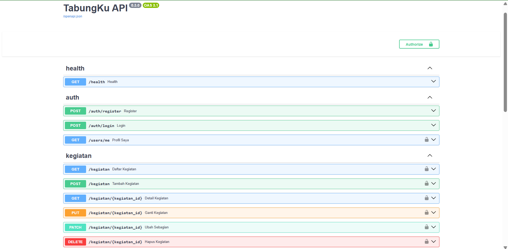
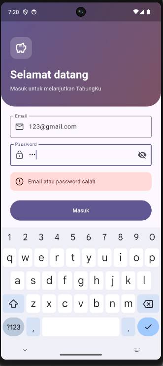
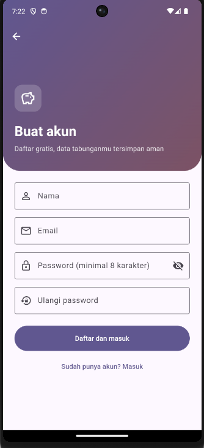
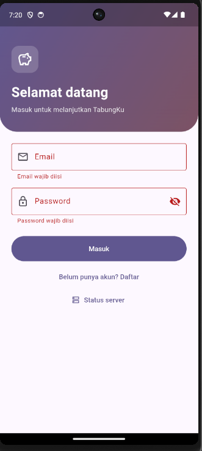
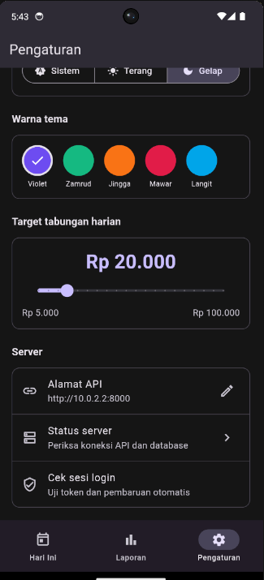
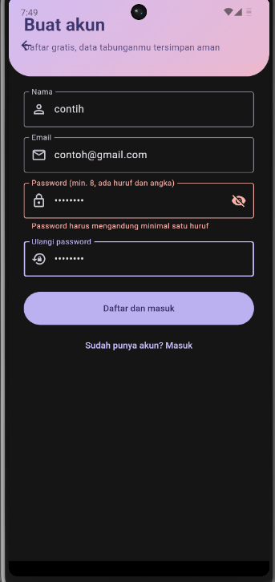

# TabungKu Cloud: Autentikasi dan Isolasi Data

Mini proyek Pemrograman Mobile, Pertemuan 10: register dan login dengan
password ber-hash Argon2, token JWT (access dan refresh), data kegiatan yang
terpisah per pengguna, serta halaman Login dan pembaruan token otomatis di
Flutter.

## Identitas

| | |
|---|---|
| Nama | Angga Aditya Nugraha |
| NIM | 20240801165 |
| Program Studi | Teknik Informatika, Universitas Esa Unggul |
| Mata Kuliah | Pemrograman Mobile (CIE511) |
| Tugas | Pertemuan 10: Autentikasi JWT, Refresh Token, dan Otorisasi Data |

## Apa yang dibangun?

Sampai Pertemuan 9, API TabungKu bisa dipakai siapa saja dan semua kegiatan
tercampur dalam satu tabel. Pertemuan 10 membuat server mengenal **siapa
penggunanya** dan membatasi apa yang boleh dilakukan:

- tabel `users`, dan setiap kegiatan punya pemilik (`user_id`),
- **register** dan **login**; password disimpan sebagai hash **Argon2**, bukan teks asli,
- login membalas dua **token JWT**: access token berumur pendek (15 menit) dan refresh token berumur panjang (7 hari),
- semua endpoint kegiatan dan laporan **wajib login** dan hanya menampilkan **data milik sendiri**,
- di Flutter: halaman Login dan Daftar, token disimpan di **secure storage**, dan `ApiClient` yang memperbarui token sendiri saat kedaluwarsa.

Pada pertemuan ini data kegiatan di aplikasi masih memakai SQLite lokal;
sambungan antara layar aplikasi dan API dilakukan di Pertemuan 11.

```
Flutter (halaman Login, Daftar, Pengaturan)
   |  AuthApi / ApiClient
   |  header: Authorization: Bearer <access token>
   v
FastAPI  --  /auth/register, /auth/login, /auth/refresh, /users/me
   |         get_current_user: membaca token, mencari pengguna
   |         /kegiatan, /laporan: hanya data milik pengguna itu
   v
MySQL  --  users, kegiatan (user_id -> users.id)   [Alembic 0002]
```

## Fitur

### Backend

- Register dengan validasi (email sah, password 8 sampai 72 karakter dengan huruf dan angka); email yang sudah terdaftar dibalas **409**
- Login memakai form OAuth2 (`username` berisi email); pesan galat **sama** untuk email salah maupun password salah
- Password di-hash dengan **Argon2** (`$argon2id$...` di database)
- JWT dengan klaim `jenis` (`access` atau `refresh`); access token ditolak di endpoint refresh dan refresh token ditolak sebagai access token
- `POST /auth/refresh` menukar refresh token dengan pasangan token baru
- `GET /users/me` untuk profil (tanpa `password_hash`)
- `POST /auth/ganti-password` (wajib login, password lama harus benar)
- **Isolasi data**: kegiatan milik pengguna lain dibalas **404** (bukan 403), untuk membaca, mengubah, maupun menghapus
- Laporan harian dan rentang juga hanya menghitung data pemilik token
- Akun yang dinonaktifkan (`aktif = 0`) ditolak (**403**) walau tokennya masih berlaku
- Kunci rahasia dan umur token diatur lewat `.env`, tidak ditulis di kode

### Flutter

- Halaman **Login** dan **Daftar** dengan validasi form dan pesan galat dari server
- Token disimpan di `flutter_secure_storage` (terenkripsi), bukan `shared_preferences`
- Sesi dipulihkan saat aplikasi dibuka; menutup lalu membuka aplikasi tidak membuat pengguna harus login ulang
- Kartu **Akun** di Pengaturan (inisial, nama, email) dengan tombol **Keluar**
- `ApiClient` menambahkan header `Authorization` dan **memperbarui token otomatis** saat server membalas 401
- Hanya **satu** refresh walau beberapa request gagal bersamaan; **auto-logout** bila refresh ditolak; tidak logout bila server tidak dapat dihubungi
- Inisial nama pengguna di kepala halaman Hari Ini

## Endpoint API

### Auth

| Metode | Alamat | Fungsi | Kode |
|---|---|---|---|
| POST | `/auth/register` | Buat akun | 201, 409 (email terdaftar), 422 |
| POST | `/auth/login` | Login (form `username` dan `password`), membalas `access_token` dan `refresh_token` | 200, 401, 403 (akun nonaktif) |
| POST | `/auth/refresh` | Tukar refresh token dengan pasangan token baru | 200, 401, 403 |
| POST | `/auth/ganti-password` | Ganti password (wajib login) | 204, 400 (password lama salah), 401, 422 |
| GET | `/users/me` | Profil pengguna yang login | 200, 401, 403 |

### Kegiatan dan laporan (wajib login)

Endpoint `GET/POST/PUT/PATCH/DELETE /kegiatan`, `GET /laporan/harian`, dan
`GET /laporan/rentang` sama seperti Pertemuan 9, tetapi sekarang wajib
mengirim `Authorization: Bearer <access token>` dan hanya mengenai data
milik pemilik token.

### Aturan token

| | Access token | Refresh token |
|---|---|---|
| Klaim `jenis` | `access` | `refresh` |
| Umur | 15 menit (`ACCESS_TOKEN_MENIT`) | 7 hari (`REFRESH_TOKEN_HARI`) |
| Dikirim ke | setiap request | hanya `/auth/refresh` |
| Dipakai sebagai | `Authorization: Bearer` | isi body `refresh_token` |

## Tampilan

<table>
  <tr>
    <td align="center" colspan="3"><br><sub>Swagger (/docs): tombol Authorize dan kelompok auth</sub></td>
  </tr>
  <tr>
    <td align="center"><br><sub>Halaman Login</sub></td>
    <td align="center"><br><sub>Halaman Daftar</sub></td>
    <td align="center"><br><sub>Login: pesan galat</sub></td>
  </tr>
  <tr>
    <td align="center"><br><sub>Pengaturan: kartu akun dan tombol Keluar</sub></td>
    <td align="center"><br><sub>Daftar: validasi password (huruf dan angka)</sub></td>
    <td></td>
  </tr>
</table>

## Sintaks yang Digunakan

### 1. Hash password dengan Argon2 (`security.py`)

```python
from pwdlib import PasswordHash

_hasher = PasswordHash.recommended()

def hash_password(password: str) -> str:
    return _hasher.hash(password)

def cek_password(password: str, hash_tersimpan: str) -> bool:
    return _hasher.verify(password, hash_tersimpan)
```

- Hash adalah fungsi **satu arah**: password asli tidak bisa dikembalikan dari hash-nya, sehingga bila database bocor password aslinya tetap aman.
- Argon2 otomatis menambahkan *salt* acak, jadi dua pengguna dengan password sama punya hash berbeda.
- Verifikasi tidak membandingkan teks, tetapi meng-hash password yang dikirim dengan parameter yang tersimpan di hash lalu mencocokkannya.
- Algoritma ini sengaja lambat dan memakan memori (`m=65536`) untuk menyulitkan serangan tebak-tebakan massal.

### 2. Membuat dan membaca JWT

```python
def _buat_token(user_id: int, jenis: str, umur: timedelta) -> str:
    sekarang = datetime.now(timezone.utc)
    payload = {
        "sub": str(user_id),   # pemilik token
        "jenis": jenis,        # access atau refresh
        "iat": sekarang,
        "exp": sekarang + umur,
    }
    return jwt.encode(payload, settings.jwt_secret, algorithm=settings.jwt_algoritma)

def baca_token(token: str, jenis: str) -> dict:
    payload = jwt.decode(token, settings.jwt_secret, algorithms=[settings.jwt_algoritma])
    if payload.get("jenis") != jenis:
        raise jwt.InvalidTokenError("jenis token tidak sesuai")
    return payload
```

- JWT terdiri atas tiga bagian `header.payload.signature`. Payload hanya di-*encode* (base64), **bukan dienkripsi**, sehingga siapa pun bisa membacanya dan tidak boleh berisi rahasia.
- Keamanannya ada di **signature**, yaitu HMAC dari header dan payload memakai `JWT_SECRET`. Token yang payload-nya diubah gagal diverifikasi.
- `sub` berisi id pengguna, `iat` waktu pembuatan, dan `exp` waktu kedaluwarsa; `jwt.decode` otomatis menolak token yang sudah lewat `exp`.
- `algorithms=[...]` wajib disebut agar penyerang tidak bisa memaksa algoritma lain.
- Klaim `jenis` mencegah refresh token (berumur panjang) dipakai sebagai access token.

### 3. Dependency pengguna yang login (`deps.py`)

```python
oauth2_scheme = OAuth2PasswordBearer(tokenUrl="/auth/login")

def get_current_user(token: str = Depends(oauth2_scheme), db: Session = Depends(get_db)) -> User:
    gagal = HTTPException(
        status.HTTP_401_UNAUTHORIZED,
        "Token tidak valid atau sudah kedaluwarsa",
        headers={"WWW-Authenticate": "Bearer"},
    )
    try:
        payload = baca_token(token, JENIS_ACCESS)
        user_id = int(payload["sub"])
    except (jwt.InvalidTokenError, KeyError, ValueError):
        raise gagal from None
    user = db.get(User, user_id)
    if user is None:
        raise gagal
    if not user.aktif:
        raise HTTPException(status.HTTP_403_FORBIDDEN, "Akun dinonaktifkan oleh admin")
    return user

DbSession = Annotated[Session, Depends(get_db)]
UserAktif = Annotated[User, Depends(get_current_user)]
```

- `OAuth2PasswordBearer` membaca header `Authorization: Bearer <token>` dan memunculkan tombol **Authorize** di Swagger.
- `Depends(get_current_user)` menjalankan fungsi ini sebelum endpoint; bila gagal, endpoint tidak pernah dijalankan.
- `Annotated[..., Depends(...)]` membuat alias `UserAktif` sehingga endpoint cukup menulis `user: UserAktif`.
- Pengguna dicari ulang di database setiap request, sehingga kolom `aktif` langsung berlaku: akun yang dinonaktifkan ditolak (403) walau tokennya masih sah.
- Semua kegagalan token dijawab dengan pesan yang sama, agar penyerang tidak mendapat petunjuk tentang penyebabnya.

### 4. Register dan login (`routers/auth.py`)

```python
@router.post("/auth/register", response_model=UserOut, status_code=status.HTTP_201_CREATED)
def register(data: UserCreate, db: DbSession):
    email = data.email.lower()
    if db.scalar(select(User).where(User.email == email)):
        raise HTTPException(status.HTTP_409_CONFLICT, "Email sudah terdaftar")
    user = User(nama=data.nama.strip(), email=email, password_hash=hash_password(data.password))
    db.add(user)
    db.commit()
    db.refresh(user)
    return user

@router.post("/auth/login", response_model=Token)
def login(form: Annotated[OAuth2PasswordRequestForm, Depends()], db: DbSession):
    user = db.scalar(select(User).where(User.email == form.username.lower()))
    if user is None or not cek_password(form.password, user.password_hash):
        raise HTTPException(status.HTTP_401_UNAUTHORIZED, "Email atau password salah")
    ...
```

- `UserOut` sengaja tidak memuat `password_hash`, dan `response_model` memastikan hash tidak pernah ikut terkirim.
- Email diubah ke huruf kecil agar `Budi@x.id` dan `budi@x.id` dianggap sama.
- Login memakai `OAuth2PasswordRequestForm` (data form, bukan JSON); kolom `username` diisi email.
- Pesan galat sama untuk email salah dan password salah, supaya orang luar tidak bisa mengetahui email mana yang terdaftar.
- Kolom `email` bersifat `unique`, jadi database juga menjaga agar tidak ada email ganda.

### 5. Refresh token (`POST /auth/refresh`)

```python
@router.post("/auth/refresh", response_model=Token)
def refresh(data: RefreshRequest, db: DbSession):
    gagal = HTTPException(status.HTTP_401_UNAUTHORIZED,
                          "Refresh token tidak valid atau sudah kedaluwarsa")
    try:
        payload = baca_token(data.refresh_token, JENIS_REFRESH)
        user_id = int(payload["sub"])
    except (jwt.InvalidTokenError, KeyError, ValueError):
        raise gagal from None
    user = db.get(User, user_id)
    if user is None:
        raise gagal
    if not user.aktif:
        raise HTTPException(status.HTTP_403_FORBIDDEN, "Akun dinonaktifkan oleh admin")
    return _pasangan_token(user.id)
```

- Access token umurnya pendek karena dikirim di setiap request sehingga paling berisiko tercuri. Refresh token hanya dikirim ke satu endpoint, jadi boleh berumur panjang.
- `baca_token(..., JENIS_REFRESH)` menolak access token yang dikirim ke endpoint ini.
- Akun nonaktif ditolak sebelum token baru dibuat, sehingga admin bisa memutus akses seseorang.

### 6. Isolasi data per pengguna

```python
def _ambil_atau_404(db: Session, kegiatan_id: int, user: User) -> Kegiatan:
    k = db.get(Kegiatan, kegiatan_id)
    if k is None or k.user_id != user.id:
        raise HTTPException(status.HTTP_404_NOT_FOUND, "Kegiatan tidak ditemukan")
    return k

stmt = select(Kegiatan).where(Kegiatan.user_id == user.id)
k = Kegiatan(**data.model_dump(), user_id=user.id)
```

- Setiap query daftar difilter dengan `user_id`, dan setiap pembuatan data mengisi `user_id` dari token, **bukan** dari data yang dikirim klien.
- Kegiatan milik orang lain dibalas **404**, bukan 403. Kode 403 membuka fakta bahwa id itu ada; dengan 404 orang luar tidak bisa menebak id mana yang dipakai.
- Satu fungsi pembantu `_ambil_atau_404` dipakai oleh GET detail, PUT, PATCH, dan DELETE agar aturannya tidak terlewat di salah satu endpoint.
- Laporan harian dan rentang menambahkan `Kegiatan.user_id == user.id` pada semua query agregatnya.

### 7. Migrasi 0002 (`alembic/versions`)

```python
def upgrade() -> None:
    op.create_table("users", sa.Column("id", sa.Integer(), primary_key=True),
                    sa.Column("email", sa.String(150), nullable=False, unique=True), ...)
    op.execute("DELETE FROM kegiatan")
    op.add_column("kegiatan", sa.Column("user_id", sa.Integer(), nullable=False))
    op.create_index("ix_kegiatan_user_id", "kegiatan", ["user_id"])
    op.create_foreign_key("fk_kegiatan_user", "kegiatan", "users",
                          ["user_id"], ["id"], ondelete="CASCADE")
```

- Kegiatan lama belum punya pemilik. Karena hanya data uji, baris itu dihapus dulu agar kolom `user_id` bisa dibuat `NOT NULL`.
- `ForeignKey ... ondelete="CASCADE"` membuat kegiatan ikut terhapus bila penggunanya dihapus, dan database menolak kegiatan yang menunjuk pengguna yang tidak ada.
- `downgrade()` membalik urutannya: hapus kunci asing, indeks, kolom, lalu tabel `users`.

### 8. Flutter: penyimpanan token dan sesi

```dart
abstract class TokenStorage {
  Future<String?> baca(String kunci);
  Future<void> tulis(String kunci, String nilai);
  Future<void> hapusSemua();
}

class SecureTokenStorage implements TokenStorage {
  final _storage = const FlutterSecureStorage();
  ...
}

final ValueNotifier<Pengguna?> pengguna = ValueNotifier<Pengguna?>(null);
String? accessToken;
String? refreshTokenSesi;
```

- Token disimpan di `flutter_secure_storage` yang memakai Keystore (Android) atau Keychain (iOS). `shared_preferences` menyimpan teks biasa yang bisa dibaca dari berkas aplikasi, jadi tidak aman untuk token.
- `TokenStorage` adalah kelas abstrak: aplikasi memakai `SecureTokenStorage`, sedangkan test memakai `MemoryTokenStorage` sehingga tidak butuh plugin native.
- `pengguna` adalah `ValueNotifier`; rute awal memakai `ValueListenableBuilder` sehingga aplikasi otomatis pindah ke Login saat `pengguna` menjadi `null`, dan ke aplikasi saat login berhasil.
- `muatSesi()` dipanggil sekali di `main()` untuk memulihkan sesi dari penyimpanan.

### 9. Flutter: `ApiClient` dengan pembaruan token otomatis

```dart
class ApiClient extends http.BaseClient {
  static Future<bool>? _sedangBerjalan;

  @override
  Future<http.StreamedResponse> send(http.BaseRequest request) async {
    final salinan = request is http.Request ? _salin(request) : null;
    final tokenAwal = accessToken;
    if (tokenAwal != null) request.headers['Authorization'] = 'Bearer $tokenAwal';

    final res = await _inner.send(request);
    if (res.statusCode != 401 || salinan == null || tokenAwal == null ||
        refreshTokenSesi == null || _tanpaRefresh.contains(request.url.path)) {
      return res;
    }
    ...
    salinan.headers['Authorization'] = 'Bearer $accessToken';
    return _inner.send(salinan);
  }

  Future<bool> _perbarui() =>
      _sedangBerjalan ??= _lakukanRefresh().whenComplete(() => _sedangBerjalan = null);
}
```

- `ApiClient` memakai pola **decorator**: membungkus `http.Client` lain dan menambahkan perilaku tanpa mengubah kelas pemanggilnya (`KegiatanApi` dan `LaporanApi` cukup memakainya sebagai client bawaan).
- Sebuah `http.Request` hanya boleh dikirim sekali, jadi salinannya dibuat sebelum dikirim agar bisa diulang dengan isi dan header yang sama.
- Saat 401, token diperbarui lalu request **diulang sekali** saja, tanpa perulangan lagi.
- `static Future<bool>? _sedangBerjalan` menyimpan refresh yang sedang berjalan. Request lain yang juga mendapat 401 ikut menunggu `Future` yang sama (`??=`), sehingga tiga request bersamaan hanya memicu **satu** refresh. Ini penting karena refresh token ikut diganti: refresh kedua dengan token lama akan ditolak.
- Endpoint `/auth/login`, `/auth/register`, dan `/auth/refresh` dikecualikan: 401 di sana berarti kredensial salah, bukan token kedaluwarsa.
- **Auto-logout** hanya bila server **menjawab** 401 atau 403 pada refresh (`hapusSesi()`). Galat jaringan, waktu habis, atau error 500 tidak menghapus sesi, supaya pengguna tidak terlempar keluar hanya karena sinyal buruk.
- `main.dart` memasang pendengar pada `pengguna`: begitu sesi dihapus, semua halaman ditutup (`popUntil`) sehingga Login terlihat.

### 10. Flutter: login dan validasi form

```dart
final res = await _client
    .post(_uri('/auth/login'), body: {'username': email, 'password': password})
    .timeout(batasWaktu);
if (res.statusCode != 200) throw ApiException.dariRespons(res);

String? validasiPasswordBaru(String? nilai) {
  final t = nilai ?? '';
  if (t.length < 8) return 'Password minimal 8 karakter';
  if (!RegExp(r'[A-Za-z]').hasMatch(t)) return 'Password harus mengandung minimal satu huruf';
  if (!RegExp(r'\d').hasMatch(t)) return 'Password harus mengandung minimal satu angka';
  return null;
}
```

- Memberi `body` berupa `Map` membuat paket `http` mengirimnya sebagai form (`application/x-www-form-urlencoded`), sesuai yang diminta endpoint login. Untuk register dipakai JSON dengan `jsonEncode`.
- Setelah daftar, aplikasi langsung login dan menutup halaman Daftar dengan `popUntil((r) => r.isFirst)`.
- Aturan password di form sama dengan aturan di server. Validasi di server adalah pagar yang wajib; validasi di form hanya memberi umpan balik cepat, karena klien bisa dilewati.
- Tombol Masuk dinonaktifkan saat proses berjalan (`_memuat`) agar tidak terkirim dua kali.

### 11. Unit test Flutter

```dart
test('tiga request bersamaan hanya memicu satu refresh', () async {
  var jumlahRefresh = 0;
  final client = ApiClient(MockClient((req) async {
    if (req.url.path == '/auth/refresh') {
      jumlahRefresh++;
      await Future<void>.delayed(const Duration(milliseconds: 50));
      return _json(_pasanganBaru);
    }
    return _balasKegiatan(req);
  }));

  final hasil = await Future.wait([
    client.get(_uri('/laporan/harian')),
    client.get(_uri('/laporan/rentang')),
    client.get(_uri('/kegiatan')),
  ]);

  expect(hasil.map((r) => r.statusCode), everyElement(200));
  expect(jumlahRefresh, 1);
});
```

- `MockClient` bertindak sebagai server palsu: token `baru` diterima dan token lain dibalas 401, sehingga siklus 401, refresh, lalu ulang bisa diuji tanpa server dan Docker.
- `delayed(50 ms)` membuat refresh cukup lama sehingga ketiga request benar-benar tumpang tindih.
- `MemoryTokenStorage` dan `setUp` menjaga setiap tes mulai dari keadaan bersih (login dengan token yang sudah kedaluwarsa).
- Perilaku yang diuji: header `Authorization`, refresh lalu ulang sekali (termasuk request POST dengan isi yang sama), satu refresh bersamaan, 401 dari login/register tidak memicu refresh, auto-logout (401 dan 403), dan **tidak** logout saat server tidak terjangkau atau error 500.

## Hasil Uji Otorisasi (Bagian G)

| No | Skenario | Hasil yang diharapkan | Hasil |
|----|----------|-----------------------|-------|
| 1 | Register Budi, lalu register lagi dengan email yang sama | 201, lalu 409 `Email sudah terdaftar` | Lulus |
| 2 | Register dengan email tanpa `@`, dan password `123` | 422 | Lulus |
| 3 | Login dengan password salah | 401 `Email atau password salah` | Lulus |
| 4 | `GET /kegiatan` tanpa token | 401 `Not authenticated` | Lulus |
| 5 | Budi login, membuat kegiatan, dan memanggil `/users/me` | 201 dan 200 tanpa `password_hash` | Lulus |
| 6 | Ani register dan login, lalu `GET /kegiatan` | 200 dengan isi `[]` | Lulus |
| 7 | Ani hapus, baca, ubah sebagian, dan ganti kegiatan milik Budi | 404 untuk keempatnya; data Budi tetap ada | Lulus |
| 8 | Token dipalsukan (isi `sub` diganti, tanda tangan tetap) | 401 `Token tidak valid atau sudah kedaluwarsa` | Lulus |

Bukti tambahan:

- **Isolasi laporan:** pada tanggal yang sama, laporan harian Ani menunjukkan `jumlah_kegiatan = 0` dan laporan Budi `jumlah_kegiatan = 1` dengan pengeluaran 15000.
- **Hash password di database:** kolom `password_hash` berawalan `$argon2id$v=19$m=65536`, bukan password asli.
- **Isi token:** header `{"alg":"HS256","typ":"JWT"}` dan payload `{"sub":"1","iat":...,"exp":...}`; tidak ada password di dalamnya.

## Hasil Uji Refresh Token (Tugas Backend)

| No | Skenario | Hasil yang diharapkan | Hasil |
|----|----------|-----------------------|-------|
| 1 | Login membalas dua token; umur access 15 menit dan refresh 7 hari | field `access_token`, `refresh_token`, `token_type` | [isi] |
| 2 | Access token dipakai di `/users/me` | 200 | [isi] |
| 3 | Refresh token dipakai sebagai Bearer | 401 | [isi] |
| 4 | Access token dikirim ke `/auth/refresh` | 401 | [isi] |
| 5 | Refresh token acak | 401 | [isi] |
| 6 | Refresh dengan refresh token yang sah | 200, pasangan token baru | [isi] |
| 7 | Akun dinonaktifkan: refresh dan `/users/me` | 403 | [isi] |
| 8 | Login password salah | 401 tanpa refresh token | [isi] |

Hasil unit test Flutter: [isi jumlah] tes lulus (`flutter test`).

## Jawaban Latihan Mandiri

**1. `POST /auth/ganti-password`.** Endpoint wajib login dan menerima `password_lama` dan `password_baru`. Password lama yang salah dibalas **400**, bukan 401: kode 401 berarti "token tidak valid" dan di aplikasi memicu pembaruan token atau logout, sehingga pengguna bisa terlempar keluar hanya karena salah mengetik password lama. Password baru tidak boleh sama dengan yang lama, dan hasil sukses dibalas 204. Perlu dicatat, token yang sudah terbit tetap berlaku sampai `exp` karena JWT bersifat *stateless*.

**2. Token berumur 1 menit.** Dengan `ACCESS_TOKEN_MENIT=1`, permintaan `/users/me` tepat setelah login berhasil (200), tetapi setelah menunggu lebih dari 1 menit server membalas **401** dengan pesan `Token tidak valid atau sudah kedaluwarsa`. Waktu `exp` tertanda tangan di dalam token, sehingga klien tidak bisa memperpanjangnya sendiri.

**3. Validasi password huruf dan angka.** Aturan dibuat di dua tempat: di Pydantic (`_cek_kekuatan`, dipakai `UserCreate` dan `GantiPassword`) dan di form Flutter (`validasiPasswordBaru`). Password `abcdefgh` ditolak karena tidak ada angka, dan `12345678` ditolak karena tidak ada huruf. Validasi di server adalah pagar yang wajib, sedangkan validasi di form hanya mempercepat umpan balik.

**4. Inisial nama pengguna.** Halaman Hari Ini memakai kepala berlatar gradient (tidak memakai `AppBar`), sehingga inisial ditampilkan sebagai `CircleAvatar` di sisi kiri kepala itu, dibaca dari `pengguna` lewat `ValueListenableBuilder`.

## Jawaban Pertanyaan Refleksi

1. **Pesan login sama untuk email salah dan password salah.** Bila pesannya berbeda, penyerang bisa mencoba banyak email dan mengetahui mana yang terdaftar (*user enumeration*), lalu fokus menebak password akun-akun itu. Pesan yang sama tidak memberi petunjuk apa pun.
2. **Payload JWT bisa dibaca siapa saja, lalu apa yang membuatnya aman.** Payload hanya di-*encode*, bukan dienkripsi, sehingga tidak boleh berisi rahasia. Keamanannya ada di **signature**: HMAC yang dihitung dengan `JWT_SECRET`, yang hanya diketahui server. Bila payload atau signature diubah, verifikasi gagal. Pengiriman token juga harus lewat HTTPS agar tidak disadap.
3. **Kelemahan JWT stateless saat admin ingin mencabut akses seketika.** Token yang sudah terbit tetap sah sampai `exp`, dan server tidak menyimpan daftar token sehingga tidak bisa "menarik kembali" token tertentu. Kolom `aktif` membantu karena pengguna dicari ulang di database pada setiap request dan saat refresh; begitu `aktif = 0`, server menolak dengan 403 walau tokennya masih berlaku.
4. **Data orang lain dibalas 404, bukan 403.** Kode 403 mengatakan "id ini ada tetapi bukan milikmu", sehingga orang luar bisa menebak id mana yang dipakai. Dengan 404, data milik orang lain tidak dapat dibedakan dari data yang memang tidak ada.
5. **Token tidak disimpan di `shared_preferences`.** `shared_preferences` menyimpan teks biasa (tidak terenkripsi) di berkas aplikasi, yang bisa terbaca dari cadangan atau perangkat yang di-*root*. `flutter_secure_storage` menyimpan data terenkripsi memakai Keystore (Android) atau Keychain (iOS).

## Cara Menjalankan

**Backend** (di folder `pertemuan10`, Docker Desktop harus menyala):

```
cp .env.example .env
```

Buka `.env` dan isi `JWT_SECRET` dengan kunci acak, misalnya hasil
`python3 -c "import secrets; print(secrets.token_hex(32))"`. Berkas `.env`
**tidak** ikut ke GitHub. Lalu:

```
docker compose up -d --build
docker compose ps
```

Migrasi Alembic (termasuk revisi 0002) berjalan otomatis saat container `api`
menyala.

| Alamat | Isi |
|---|---|
| `http://localhost:8000/docs` | Swagger; klik **Authorize** untuk login |
| `http://localhost:8000/health` | Status API dan database |
| `http://localhost:8081` | Adminer (Server `mysql`, user dan password sesuai `.env`) |

**Aplikasi Flutter** (di folder `pertemuan10/mobile`; emulator Android dan server harus menyala):

```
flutter pub get
flutter test
flutter run -d emulator-5554
```

Emulator mengakses server lewat `http://10.0.2.2:8000` (alamat bawaan, bisa
diubah di Pengaturan).

## Struktur Folder

```
pertemuan10/
  docker-compose.yml         MySQL + API + Adminer (meneruskan JWT_SECRET dan umur token)
  .env.example               contoh variabel lingkungan (.env tidak di-commit)
  backend/
    Dockerfile, start.sh, requirements.txt, alembic.ini
    alembic/versions/
      0001_buat_tabel_kegiatan.py
      0002_users_dan_pemilik_kegiatan.py
    app/
      main.py                aplikasi FastAPI dan pendaftaran router
      config.py              pengaturan (JWT_SECRET, umur token) dari environment
      database.py            engine, SessionLocal, Base, get_db
      models.py              User dan Kegiatan (user_id)
      schemas.py             skema Pydantic dan aturan bisnis
      security.py            hash Argon2, pembuatan dan pembacaan JWT
      deps.py                get_current_user, DbSession, UserAktif
      routers/
        auth.py              register, login, refresh, ganti-password, users/me
        kegiatan.py          CRUD /kegiatan (hanya data pemilik)
        laporan.py           /laporan/harian dan /laporan/rentang
        health.py            GET /health
  mobile/
    lib/
      models/pengguna.dart          model Pengguna
      state/sesi.dart               sesi: token dan pengguna yang login
      services/
        token_storage.dart          penyimpanan token (secure dan memori)
        api_client.dart             ApiClient: header Authorization dan auto-refresh
        auth_api.dart               register, login, refresh, profil
        api_exception.dart          penerjemah galat FastAPI
        pesan_galat.dart            pesan galat ramah pengguna
      pages/
        login_page.dart, register_page.dart, pengaturan_page.dart
      utils/validasi.dart           validasi password
    test/                    unit test (MockClient dan MemoryTokenStorage)
  Docs/
    readme.md                berkas ini
    img/                     tangkapan layar
```