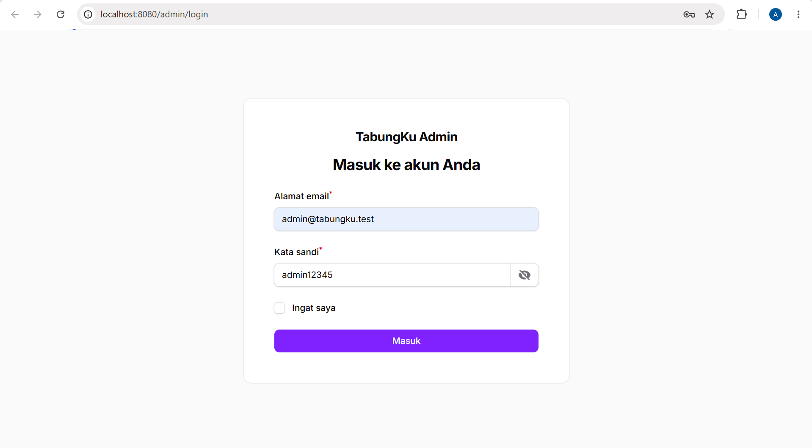
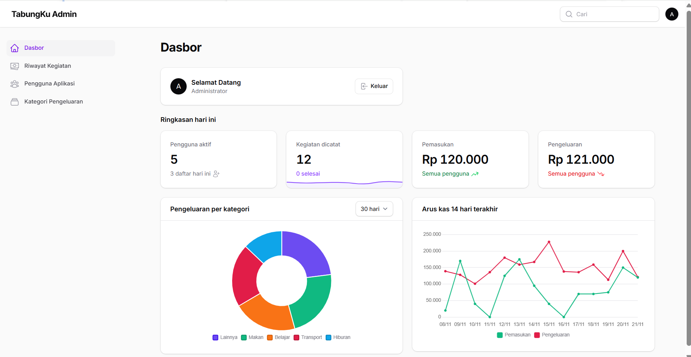
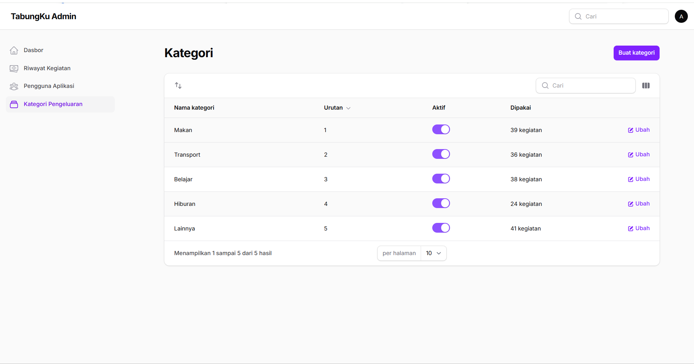

# TabungKu Cloud: Pertemuan 12

Dashboard admin **TabungKu Admin** (Laravel 13 + Filament 5) yang berbagi satu database MySQL dengan API FastAPI dan aplikasi Flutter. Pada pertemuan ini kategori pengeluaran juga dipindah dari teks bebas menjadi tabel `kategori` yang dikelola admin.

## Fitur

**Backend (FastAPI)**
- Tabel `kategori` (id, nama, urutan, aktif) dengan migrasi Alembic `0003`, berisi data awal Makan, Transport, Belajar, Hiburan, Lainnya.
- `kegiatan.kategori_id` sebagai foreign key (`ON DELETE RESTRICT`), data lama dipindahkan otomatis oleh migrasi.
- Endpoint baru `GET /kategori`; `GET /laporan` ikut memakai kategori dari tabel.
- Skrip data contoh: `scripts/seed_demo.py`.

**Aplikasi Flutter**
- Pilihan kategori di form kegiatan diambil dari server, bukan daftar tetap di kode.
- Tetap bisa dipakai offline (repository SQLite).

**Dashboard admin (Filament)**
- Login admin dengan tabel `admins` terpisah dari pengguna aplikasi.
- **Kategori Pengeluaran**: tambah, ubah, geser urutan, saklar aktif; tidak bisa dihapus bila sudah dipakai kegiatan.
- **Pengguna Aplikasi**: lihat dan nonaktifkan akun (akun nonaktif ditolak API dengan 403).
- **Riwayat Kegiatan**: lihat dan hapus, dengan filter tipe, kategori, pengguna, dan rentang tanggal.
- Dashboard: ringkasan hari ini, grafik donat pengeluaran per kategori (7/30/365 hari), dan grafik arus kas 14 hari.

## Tangkapan Layar

| Login admin | Dashboard |
|---|---|
|  |  |

| Kategori Pengeluaran | Aplikasi (halaman Hari Ini) |
|---|---|
|  |  |

## Menjalankan

```bash
cd pertemuan12
cp .env.example .env
docker compose up -d --build
docker compose exec api python -m scripts.seed_demo   # data contoh (opsional)
```

| Layanan | Alamat | Akun |
|---|---|---|
| API + Swagger | http://localhost:8000/docs | daftar dari aplikasi, atau akun contoh `ani@contoh.id` (password `rahasia123`) |
| Dashboard admin | http://localhost:8080/admin | `admin@tabungku.test` / `admin12345` |
| Adminer | http://localhost:8081 | server `mysql`, user dan password dari `.env` |

Aplikasi Flutter:

```bash
cd mobile
flutter pub get
flutter run        # emulator Android memakai http://10.0.2.2:8000
```

## Pengujian

```bash
docker compose exec admin php artisan test    # 9 test lulus (dashboard, widget, filter)
cd mobile && flutter test                     # 91 test lulus
```

Tes dashboard membaca database compose yang sama (tabel dibuat oleh Alembic), sehingga tidak memakai `RefreshDatabase`.

## Struktur

```
pertemuan12/
├── backend/   FastAPI + Alembic (model Kategori, router /kategori, scripts/seed_demo.py)
├── admin/     Laravel + Filament (Resources, Widgets, tests/Feature/DashboardTest.php)
├── mobile/    Flutter (kategori dari API, repository pattern)
├── Docs/      tangkapan layar
└── docker-compose.yml
```