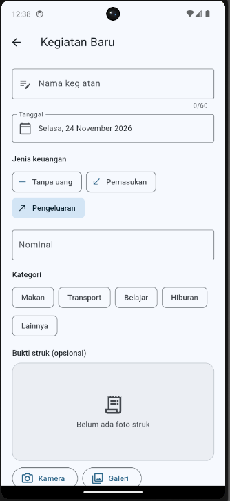
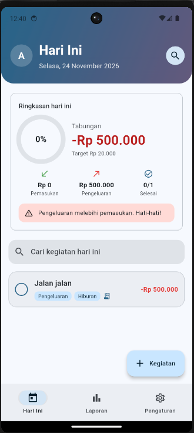
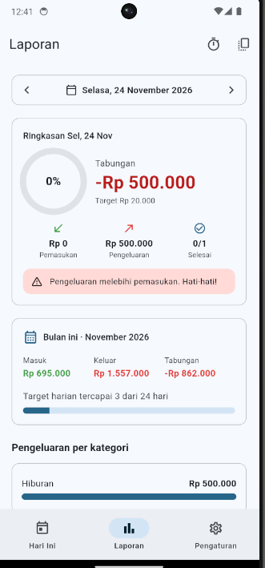

# TabungKu Cloud: Pertemuan 13

Upload foto bukti struk dari aplikasi ke server, ditampilkan di dashboard admin, dilengkapi tes otomatis backend (pytest). Bagian tugas: laporan bulanan, ekspor CSV, dan kartu "Bulan ini" di aplikasi.

## Fitur

**Backend (FastAPI)**
- Kolom `kegiatan.bukti` (migrasi Alembic `0004`) dan volume Docker `uploads` untuk menyimpan foto.
- `POST /kegiatan/{id}/bukti` mengunggah foto; `DELETE /kegiatan/{id}/bukti` menghapusnya. Foto disajikan di `/uploads/<nama>`.
- Validasi sisi server: jenis berkas (JPG/PNG/WEBP, selain itu 415), ukuran maksimal 2 MB (413), pengecekan isi berkas lewat *magic bytes*, dan nama berkas acak (UUID).
- Foto lama otomatis dihapus saat diganti atau saat kegiatan dihapus.
- Tugas: `GET /laporan/bulanan` dan `GET /laporan/ekspor.csv` (dengan pencegahan CSV injection dan batas 366 hari).

**Aplikasi Flutter**
- Ambil foto dari kamera atau galeri (`image_picker`), pratinjau, ganti, hapus, dan layar penuh dengan zoom.
- Foto diunggah setelah kegiatan tersimpan; bila unggahan gagal, kegiatan tetap tersimpan dan pengguna diberi tahu.
- Ikon struk pada kegiatan yang punya foto.
- Tugas: kartu **Bulan ini** di halaman Laporan (total masuk/keluar/tabungan dan progress target harian).

**Dashboard admin (Filament)**
- Kolom thumbnail **Struk** pada tabel dan foto besar pada modal "Lihat".
- Tombol **Ekspor CSV** yang mengikuti filter dan pencarian tabel yang sedang aktif.

## Tangkapan Layar

| Form kegiatan dengan kotak Bukti struk | Halaman Hari Ini | Kartu Bulan ini (Laporan) |
|---|---|---|
|  |  |  |

## Pengujian

```bash
docker compose exec api pytest --cov=app --cov-report=term-missing   # 28 test, cakupan di atas 85%
docker compose exec admin php artisan test                           # 10 test
cd mobile && flutter test                                            # 96 test
```

Tes backend memakai SQLite di memori dan folder unggahan sementara, sehingga data MySQL asli tidak tersentuh.

## Menjalankan

```bash
cd pertemuan13
cp .env.example .env
docker compose up -d --build
cd mobile && flutter pub get && flutter run
```

| Layanan | Alamat |
|---|---|
| API + Swagger | http://localhost:8000/docs |
| Dashboard admin | http://localhost:8080/admin (`admin@tabungku.test` / `admin12345`) |

## Struktur

```
pertemuan13/
├── backend/   FastAPI + Alembic (bukti.py, endpoint upload, laporan bulanan dan CSV, tests/)
├── admin/     Laravel + Filament (kolom Struk, tombol Ekspor CSV)
├── mobile/    Flutter (image_picker, BuktiStruk, KartuBulanan)
├── Docs/      tangkapan layar
└── docker-compose.yml
```

## Catatan

- `http_parser` dan `image_picker` dipasang pada versi yang kompatibel dengan Dart 3.5.3 di perangkat pengembangan.
- Foto struk hanya tersedia saat aplikasi memakai server (mode data `api`), bukan mode lokal SQLite.