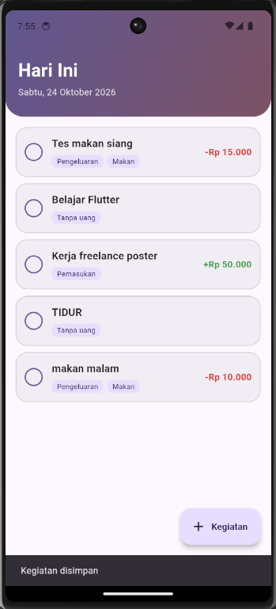
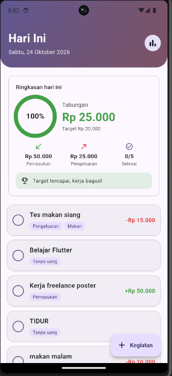
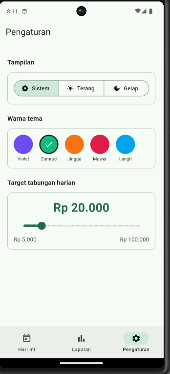
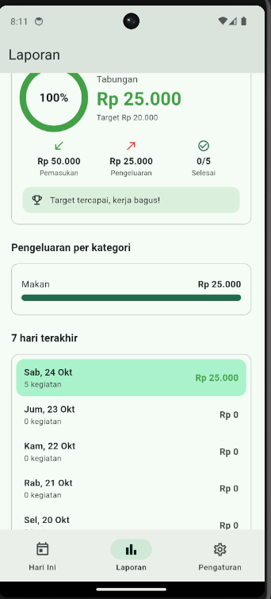
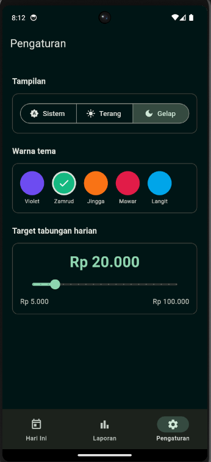
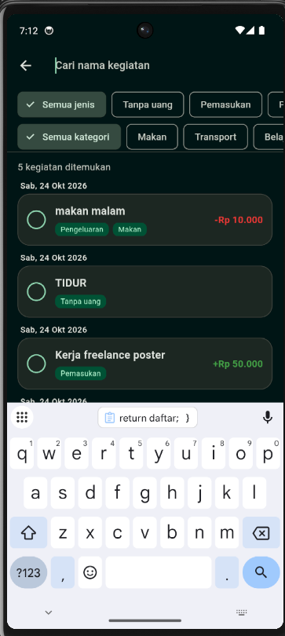

# TabungKu

Mini proyek Pemrograman Mobile, Pertemuan 7: aplikasi Flutter untuk mencatat
kegiatan harian sekaligus uang masuk dan keluar.

## Identitas

| | |
|---|---|
| Nama | Angga Aditya Nugraha |
| NIM | 20240801165 |
| Program Studi | Teknik Informatika, Universitas Esa Unggul |
| Mata Kuliah | Pemrograman Mobile (CIE511) |
| Tugas | Pertemuan 7: Mini Proyek |

## Apa itu TabungKu?

TabungKu adalah aplikasi pencatat kegiatan harian yang menggabungkan *to-do
list* dengan catatan keuangan. Setiap kegiatan bisa dikategorikan sebagai:

- **Tanpa uang**, misalnya "Belajar Flutter di perpustakaan",
- **Pemasukan**, misalnya "Kerja freelance desain poster", atau
- **Pengeluaran** dengan kategori (Makan, Transport, Belajar, Hiburan, Lainnya).

Dari catatan itu aplikasi menghitung **tabungan** harian
(`pemasukan - pengeluaran`) lalu membandingkannya dengan **target harian**
yang bisa diatur pengguna. Semua nominal dihitung, baik kegiatan yang sudah
selesai maupun yang belum. Seluruh data disimpan lokal di SQLite sehingga
tetap ada setelah aplikasi ditutup.

## Fitur

### Fitur utama

- Tambah, ubah, hapus (dengan dialog konfirmasi), dan centang selesai pada kegiatan
- Form dengan validasi (nama wajib diisi, nominal wajib dan harus lebih dari 0) dan pemilih tanggal
- Kartu ringkasan harian: jumlah kegiatan selesai, pemasukan, pengeluaran, tabungan, dan progres target berbentuk lingkaran beranimasi
- Pesan otomatis: target tercapai, kurang berapa lagi, atau peringatan saat pengeluaran melebihi pemasukan (tabungan negatif tampil merah)
- Halaman **Laporan**: ringkasan per tanggal, pengeluaran per kategori, dan daftar 7 hari terakhir yang bisa di-tap
- Halaman **Pengaturan**: mode Sistem/Terang/Gelap, 5 pilihan warna tema, dan target tabungan harian
- Navigasi 3 tab (Hari Ini, Laporan, Pengaturan) dengan data yang selalu sinkron

### Pengembangan lanjutan yang dipilih

1. **Pencarian dan filter**: mencari nama kegiatan (`LIKE`) di semua tanggal, disaring berdasarkan jenis dan kategori.
2. **Ekspor laporan**: menyalin laporan harian sebagai teks ke papan klip (`Clipboard`).

## Tampilan di Emulator Android Studio

Diuji pada emulator Android Studio: **Pixel 6, Android 14 (API 34)**.

<table>
  <tr>
    <td align="center"><br><sub>Hari Ini: daftar kegiatan</sub></td>
    <td align="center"><br><sub>Laporan Hari Ini</sub></td>
    <td align="center"><br><sub>Pengaturan (mode terang)</sub></td>
  </tr>
  <tr>
    <td align="center"><br><sub>Laporan</sub></td>
    <td align="center"><br><sub>Pengaturan (mode gelap)</sub></td>
    <td align="center"><br><sub>cari kegiatan</sub></td>
  </tr>
</table>


## Sintaks yang Digunakan

### 1. Model data: `enum`, `factory`, dan `extension`

```dart
enum Tipe { tanpa, pemasukan, pengeluaran }

factory Kegiatan.fromMap(Map<String, Object?> m) => Kegiatan(
      id: m['id'] as int,
      tipe: Tipe.values.byName(m['tipe'] as String),
      // ...
    );

extension TipeNama on Tipe {
  String get nama => switch (this) {
        Tipe.tanpa => 'Tanpa uang',
        Tipe.pemasukan => 'Pemasukan',
        Tipe.pengeluaran => 'Pengeluaran',
      };
}
```

- `enum` membatasi nilai jenis keuangan hanya pada tiga pilihan.
- `factory ... fromMap` membuat objek dari satu baris hasil query SQLite; pasangannya `toMap()` mengubah objek kembali menjadi `Map` untuk disimpan.
- `byName` mengubah teks di database menjadi nilai `enum`.
- `extension` menambahkan properti `nama` pada `Tipe` tanpa mengubah enum-nya, dan `switch` berbentuk ekspresi mengembalikan nilai untuk tiap kasus.

### 2. Format tanggal dan rupiah

```dart
String kunciTanggal(DateTime d) =>
    '${d.year}-${d.month.toString().padLeft(2, '0')}-${d.day.toString().padLeft(2, '0')}';

String rupiah(int nilai) {
  final teks = nilai.abs().toString();
  final buf = StringBuffer();
  for (var i = 0; i < teks.length; i++) {
    if (i > 0 && (teks.length - i) % 3 == 0) buf.write('.');
    buf.write(teks[i]);
  }
  return '${nilai < 0 ? '-' : ''}Rp $buf';
}
```

- Tanggal disimpan sebagai teks `yyyy-MM-dd` (contoh `2026-10-24`) karena urutan teksnya sama dengan urutan waktunya, sehingga bisa dipakai di `ORDER BY` dan `BETWEEN`.
- `padLeft(2, '0')` melengkapi angka satu digit menjadi dua digit.
- `rupiah()` menyisipkan titik tiap tiga digit memakai `StringBuffer`, dan mengurus tanda minus untuk tabungan negatif.

### 3. Database SQLite (`sqflite`)

```dart
static Future<Database>? _bukaDb;
static Future<Database> get _database => _bukaDb ??= _buka();

return openDatabase(
  p.join(folder, 'tabungku.db'),
  version: 1,
  onCreate: (db, versi) async {
    await db.execute('CREATE TABLE kegiatan (...)');
  },
);

await db.insert('kegiatan', k.toMap()..remove('id'));
await db.update('kegiatan', {'selesai': 1}, where: 'id = ?', whereArgs: [id]);
await db.delete('kegiatan', where: 'id = ?', whereArgs: [id]);
```

- `??=` membuka database sekali saja lalu memakai ulang hasilnya.
- `onCreate` hanya berjalan saat database pertama kali dibuat.
- Tanda `?` pada `where` dan `whereArgs` adalah parameter terikat, sehingga nilai tidak disambung langsung ke teks SQL (aman dari SQL injection).
- `..remove('id')` (cascade) menghapus kunci `id` dari map sebelum insert agar `AUTOINCREMENT` yang mengisinya.

### 4. Query laporan: `SUM`, `CASE WHEN`, `COALESCE`, `GROUP BY`

```sql
SELECT COUNT(*) AS jumlah,
       COALESCE(SUM(selesai), 0) AS selesai,
       COALESCE(SUM(CASE WHEN tipe = 'pemasukan'
                         THEN nominal END), 0) AS masuk
FROM kegiatan
WHERE tanggal = ?
```

```sql
SELECT kategori, SUM(nominal) AS total
FROM kegiatan
WHERE tanggal = ? AND tipe = 'pengeluaran'
GROUP BY kategori
ORDER BY total DESC
```

- `CASE WHEN` menjumlahkan nominal hanya untuk jenis tertentu dalam satu query.
- `COALESCE` mengganti `NULL` (saat tidak ada data) menjadi `0`.
- `GROUP BY` mengelompokkan pengeluaran per kategori, `ORDER BY ... DESC` mengurutkan dari yang terbesar.
- Angka dihitung di database, bukan dijumlahkan di Dart, karena database memang dirancang untuk agregasi dan hasilnya langsung berupa satu baris ringkas.

### 5. Pencarian dengan syarat dinamis (`LIKE`)

```dart
final syarat = <String>[];
final args = <Object?>[];
if (kata.trim().isNotEmpty) {
  syarat.add('judul LIKE ?');
  args.add('%${kata.trim()}%');
}
if (tipe != null) {
  syarat.add('tipe = ?');
  args.add(tipe.name);
}
final baris = await db.query(
  'kegiatan',
  where: syarat.isEmpty ? null : syarat.join(' AND '),
  whereArgs: args.isEmpty ? null : args,
);
```

- Syarat `WHERE` dirakit sesuai filter yang dipakai, lalu digabung dengan `AND`.
- `%kata%` pada `LIKE` berarti "mengandung kata tersebut di bagian mana pun".

### 6. State yang sinkron antar halaman: `ValueNotifier`

```dart
final ValueNotifier<int> versiData = ValueNotifier<int>(0);

// di DbHelper, setelah tambah/ubah/hapus:
versiData.value++;

// di halaman:
versiData.addListener(_muat);   // initState
versiData.removeListener(_muat); // dispose
```

- Setiap perubahan data menaikkan `versiData`, dan semua halaman yang mendengarkannya memuat ulang tampilan tanpa restart.
- `removeListener` di `dispose()` wajib agar tidak terjadi kebocoran memori dan error pada halaman yang sudah ditutup.

### 7. Menampilkan data async: `FutureBuilder`

```dart
FutureBuilder<DataHari>(
  future: _future,
  builder: (context, snapshot) {
    if (snapshot.hasError) return Center(child: Text('Galat: ${snapshot.error}'));
    if (!snapshot.hasData) return const Center(child: CircularProgressIndicator());
    final data = snapshot.data!;
    // tampilkan data
  },
)
```

- Satu widget menangani tiga kondisi: galat, memuat, dan berhasil.
- Operator `!` menegaskan nilai tidak null setelah `hasData` dicek.

### 8. Form dan validasi

```dart
final _kunciForm = GlobalKey<FormState>();

TextFormField(
  controller: _judulC,
  validator: (v) => (v == null || v.trim().isEmpty)
      ? 'Nama kegiatan wajib diisi'
      : null,
)

TextFormField(
  keyboardType: TextInputType.number,
  inputFormatters: [FilteringTextInputFormatter.digitsOnly],
)

if (!_kunciForm.currentState!.validate()) return;
```

- `validator` mengembalikan pesan galat, atau `null` bila isian benar.
- `validate()` menjalankan semua validator; bila ada yang gagal, penyimpanan dibatalkan.
- `digitsOnly` membuat kolom nominal hanya menerima angka.
- `TextEditingController` selalu di-`dispose()` di `dispose()` State.
- `showDatePicker` dipakai untuk memilih tanggal.

### 9. Widget antarmuka

```dart
ChoiceChip(
  label: Text(t.nama),
  selected: _tipe == t,
  onSelected: (_) => setState(() => _tipe = t),
)

Dismissible(
  key: ValueKey(k.id),
  direction: DismissDirection.endToStart,
  confirmDismiss: (_) => _konfirmasiHapus(k),
  background: Container(/* latar merah dengan ikon hapus */),
  child: KegiatanTile(/* ... */),
)

CustomScrollView(slivers: [
  SliverToBoxAdapter(child: _Header(/* ... */)),
  SliverList.separated(/* ... */),
])

NavigationBar(selectedIndex: _tab, destinations: [/* ... */])
IndexedStack(index: _tab, children: [/* tiga halaman */])
```

- `ChoiceChip` dipakai untuk memilih jenis dan kategori (satu pilihan aktif).
- `Dismissible` memungkinkan geser kiri untuk menghapus; `confirmDismiss` menampilkan dialog `AlertDialog` (Batal/Hapus) lebih dulu.
- `CustomScrollView` dengan *sliver* membuat header dan daftar ikut menggulir dalam satu area.
- `IndexedStack` menjaga state tiap tab tetap hidup saat berpindah.

### 10. Animasi

```dart
TweenAnimationBuilder<double>(
  tween: Tween<double>(begin: 0, end: persen),
  duration: const Duration(milliseconds: 700),
  curve: Curves.easeOutCubic,
  builder: (context, v, _) => CircularProgressIndicator(value: v),
)

AnimatedContainer(duration: const Duration(milliseconds: 200), /* ... */)
AnimatedSize(duration: const Duration(milliseconds: 200), /* ... */)
```

- `TweenAnimationBuilder` menganimasikan progres lingkaran dari 0 sampai nilai tujuan tanpa perlu `AnimationController`.
- `AnimatedContainer` menganimasikan perubahan centang, dan `AnimatedSize` menganimasikan kemunculan kolom nominal dan kategori pada form.

### 11. Tema dan pengaturan tersimpan

```dart
ThemeData(useMaterial3: true, colorSchemeSeed: seed, brightness: b)

ListenableBuilder(
  listenable: Listenable.merge([modeTema, indeksWarna]),
  builder: (context, _) { /* MaterialApp */ },
)

final prefs = await SharedPreferences.getInstance();
await prefs.setInt('target', nilai);
final target = prefs.getInt('target') ?? targetBawaan;
```

- `colorSchemeSeed` membuat seluruh palet Material 3 dari satu warna dasar.
- `ThemeMode` (sistem/terang/gelap) dan indeks warna disimpan di `ValueNotifier`, sehingga tema berganti seketika.
- `SharedPreferences` menyimpan pengaturan sederhana; operator `??` memberi nilai bawaan saat belum pernah disimpan.

### 12. Navigasi bernama (*named routes*)

```dart
onGenerateRoute: (settings) {
  switch (settings.name) {
    case '/form':
      final k = settings.arguments as Kegiatan?;
      return MaterialPageRoute(builder: (_) => FormKegiatanPage(kegiatan: k));
    case '/cari':
      return MaterialPageRoute(builder: (_) => const CariPage());
  }
  return null;
},

Navigator.pushNamed(context, '/form', arguments: k);
Navigator.pop(context, true);
```

- `arguments` membawa objek `Kegiatan` ke form: bila `null` berarti mode tambah, bila terisi berarti mode ubah.
- `pop(context, true)` mengirim hasil ke halaman sebelumnya, yang dipakai untuk menampilkan *snackbar* "Kegiatan disimpan".

### 13. Papan klip

```dart
await Clipboard.setData(ClipboardData(text: teks.toString().trimRight()));
```

- Laporan disusun dengan `StringBuffer.writeln()` lalu disalin sebagai teks biasa.

### 14. `async`/`await` dan *null safety*

```dart
Future<void> main() async {
  WidgetsFlutterBinding.ensureInitialized();
  await muatPengaturan();
  runApp(const TabungKuApp());
}

final Tipe? tipe;            // boleh null
tipe?.name                   // aman bila null
final judul = k?.judul ?? '' // nilai cadangan bila null
if (!mounted) return;        // cek sebelum memakai context setelah await
```

- `main()` dibuat `async` agar pengaturan selesai dimuat sebelum aplikasi tampil.
- `WidgetsFlutterBinding.ensureInitialized()` wajib dipanggil sebelum kode async dijalankan di `main()`.
- `?`, `?.`, `??`, dan `!` adalah operator *null safety* Dart.

## Cara Menjalankan

Prasyarat: Flutter SDK dan emulator atau perangkat Android. Paket `sqflite`
tidak mendukung web atau desktop, jadi aplikasi dijalankan di Android.

```
flutter pub get
flutter run
```

## Struktur Folder

```
lib/
  main.dart                  titik masuk, tema, named routes
  data/db_helper.dart        SQLite: CRUD, query ringkasan, laporan, pencarian
  models/kegiatan.dart       model Kegiatan, Ringkasan, enum Tipe
  state/pengaturan.dart      mode tema, warna, target (SharedPreferences)
  utils/format.dart          format rupiah dan tanggal
  pages/                     beranda, form, laporan, pengaturan, cari, shell
  widgets/                   kegiatan_tile, ringkasan_card
docs/screenshots/            tangkapan layar dari emulator
```