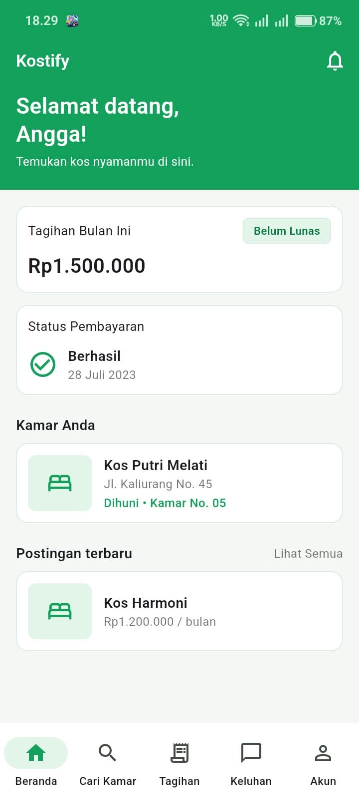
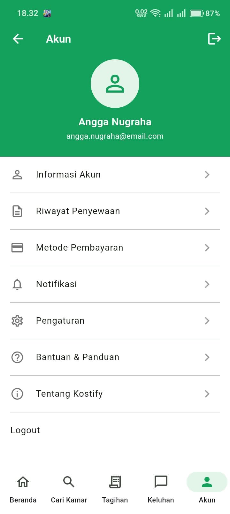
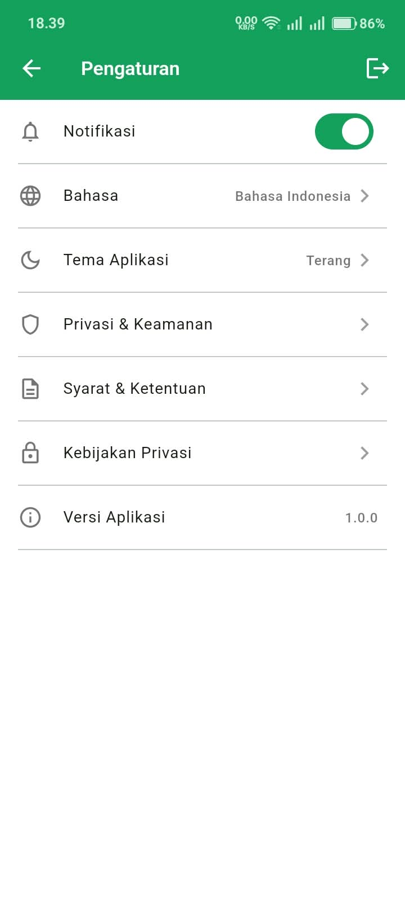

# UTS Pemrograman Mobile

## Kostify: Aplikasi Mobile Pencarian dan Pemesanan Kos


---

## Identitas Mahasiswa

| | |
|---|---|
| **Nama** | Angga Aditya Nugraha |
| **NIM** | 20240801165 |
| **Program Studi** | Teknik Informatika |
| **Fakultas** | Ilmu Komputer |
| **Mata Kuliah** | Pemrograman Mobile |
| **Tugas** | Ujian Tengah Semester (UTS) |

---

## Tentang Proyek

**Kostify** adalah prototipe aplikasi mobile untuk penyewa kos. Aplikasi ini dibuat dengan **Flutter** dan mengikuti desain antarmuka yang dirancang di Figma.

Tujuannya adalah mempermudah penyewa dalam mengurus kebutuhan kos dari satu aplikasi, mulai dari **mencari kos, memesan kamar, membayar tagihan, sampai menyampaikan keluhan**, tanpa harus berurusan langsung dengan pemilik secara manual.

Prototipe ini fokus pada sisi **penyewa**. Semua data masih berupa data contoh (dummy) agar alur penggunaan dan tampilan antarmuka dapat diuji tanpa server.

### Dokumen dan Desain

| Dokumen | Tautan |
|---|---|
| Desain Figma | **https://www.figma.com/design/sAI1qnUWXlhOGgyBFGE1wl/Untitled?node-id=33-1965&t=WTYoDA8ZHwT5iXcR-1** |
| Alur Figma | **https://www.figma.com/proto/sAI1qnUWXlhOGgyBFGE1wl/Untitled?node-id=0-1&p=f&t=lZQR4CvgOQg5slWs-0&scaling=min-zoom&content-scaling=fixed&page-id=0%3A1&starting-point-node-id=33%3A1964&fuid=1580874850967824840** |
| Business Requirement Document | [BRD Kostify Mobile.pdf](BRD%20Kostify%20Mobile.pdf) |
| Product Requirement Document | [PRD Kostify Mobile.pdf](PRD%20Kostify%20Mobile.pdf) |
---

## Tampilan Aplikasi

<table>
  <tr>
    <td align="center"><br><sub><b>Login</b></sub></td>
    <td align="center"><br><sub><b>Beranda</b></sub></td>
    <td align="center"><br><sub><b>Cari Kamar</b></sub></td>
  </tr>
  <tr>
    <td align="center"><br><sub><b>Detail Kamar</b></sub></td>
    <td align="center"><br><sub><b>Lokasi</b></sub></td>
    <td align="center"><br><sub><b>Form Booking</b></sub></td>
  </tr>
  <tr>
    <td align="center"><br><sub><b>Tagihan</b></sub></td>
    <td align="center"><br><sub><b>Pembayaran</b></sub></td>
    <td align="center"><br><sub><b>Pengajuan Keluhan</b></sub></td>
  </tr>
  <tr>
    <td align="center"><br><sub><b>Akun</b></sub></td>
    <td align="center"><br><sub><b>Pengaturan</b></sub></td>
    <td></td>
  </tr>
</table>

---

## Fitur Utama

- **Login** dengan akun demo, lengkap dengan validasi dan indikator loading.
- **Beranda** yang menampilkan tagihan bulan ini, status pembayaran terakhir, kamar yang sedang dihuni, dan postingan kos terbaru.
- **Cari Kamar** dengan pencarian teks, filter lokasi, fasilitas, dan rentang harga, serta tombol favorit.
- **Detail Kamar** berisi galeri foto yang bisa digeser, rating, deskripsi, dan fasilitas.
- **Lokasi** berupa tampilan peta sederhana dengan tombol Lihat Peta dan Lihat Rute.
- **Form Booking** dengan pemilih tanggal masuk, durasi sewa, catatan, dan estimasi biaya yang dihitung otomatis (sewa ditambah biaya admin).
- **Tagihan** dengan tab Aktif dan Riwayat. Booking baru otomatis menjadi tagihan.
- **Pembayaran** dengan pilihan metode dan simulasi proses pembayaran. Setelah berhasil, tagihan berpindah ke Riwayat dan Beranda ikut diperbarui.
- **Keluhan** untuk membuat keluhan, melihat detailnya, dan menandainya selesai.
- **Akun** berisi profil, menu informasi akun, riwayat penyewaan, dan logout.
- **Pengaturan** dengan pengaturan notifikasi, bahasa, tema, dan informasi aplikasi.

---

## Teknologi

| Komponen | Keterangan |
|---|---|
| Framework | Flutter (Material 3) |
| Bahasa | Dart |
| Font | Poppins (paket `google_fonts`) |
| Manajemen state | `setState` dan `ValueNotifier` |
| Data | Data contoh di memori (`lib/data/dummy.dart`) |
| Desain | Figma |

---

## Struktur Proyek

```
.
├── README.md
├── BRD Kostify Mobile.pdf
├── img/                          # Screenshot aplikasi untuk README
└── prototype_kostify/            # Proyek Flutter
    └── lib/
        ├── main.dart             # Titik masuk aplikasi dan navigasi bawah
        ├── nav.dart              # Penanda tab navigasi
        ├── theme.dart            # Warna dan tema aplikasi
        ├── utils.dart            # Format rupiah dan tanggal
        ├── data/
        │   └── dummy.dart        # Data contoh (kos, tagihan, keluhan, pengaturan)
        ├── widgets/              # Komponen yang dipakai ulang
        │   ├── app_card.dart
        │   ├── status_chip.dart
        │   └── foto_kos.dart
        └── screens/              # Halaman aplikasi
            ├── login_screen.dart
            ├── beranda_screen.dart
            ├── cari_kamar_screen.dart
            ├── detail_kamar_screen.dart
            ├── lokasi_screen.dart
            ├── form_booking_screen.dart
            ├── tagihan_screen.dart
            ├── pembayaran_screen.dart
            ├── keluhan_screen.dart
            ├── akun_screen.dart
            └── pengaturan_screen.dart
```

---

## Cara Menjalankan

### Prasyarat

- Flutter SDK 3.22 atau lebih baru
- Android Studio (atau emulator Android) atau perangkat Android dengan USB debugging
- Koneksi internet, karena foto kos dimuat dari internet

### Langkah

```bash
# 1. Clone repositori
git clone <URL-REPOSITORI>
cd <NAMA-REPOSITORI>/prototype_kostify

# 2. Unduh dependensi
flutter pub get

# 3. Lihat perangkat yang tersedia
flutter devices

# 4. Jalankan aplikasi
flutter run -d <ID-PERANGKAT>
```

### Akun Demo

Akun berikut juga ditampilkan di halaman login prototipe, dengan tombol **Isi otomatis**.

| | |
|---|---|
| **Email** | `admin@admin.com` |
| **Password** | `123` |

---

## Batasan Prototipe

Karena ini prototipe untuk keperluan UTS, beberapa bagian masih berupa simulasi:

- Data tersimpan di memori saja dan kembali ke kondisi awal saat aplikasi ditutup.
- Pembayaran adalah simulasi, belum terhubung ke payment gateway.
- Peta pada halaman Lokasi adalah gambar sederhana, belum memakai Google Maps.
- Login Google, Lupa Password, dan Daftar belum tersedia.
- Pilihan Bahasa dan Tema di Pengaturan baru tersimpan sebagai label, belum mengubah tampilan.
- Foto kos dimuat dari internet. Jika koneksi tidak tersedia, tampil kotak hijau sebagai pengganti.

---

## Rencana Pengembangan

- Menghubungkan aplikasi ke backend dan basis data.
- Integrasi payment gateway untuk pembayaran sungguhan.
- Peta interaktif dengan rute menuju lokasi kos.
- Autentikasi yang sebenarnya, termasuk pendaftaran dan login Google.
- Notifikasi push untuk tagihan dan status keluhan.
- Dukungan mode gelap dan multi bahasa.

---

## Pembuat

**Angga Aditya Nugraha** (20240801165)
Teknik Informatika, Fakultas Ilmu Komputer

GitHub: [anggaadityanu](https://github.com/anggaadityanu)

---

<sub>Dibuat untuk memenuhi tugas UTS mata kuliah Pemrograman Mobile.</sub>