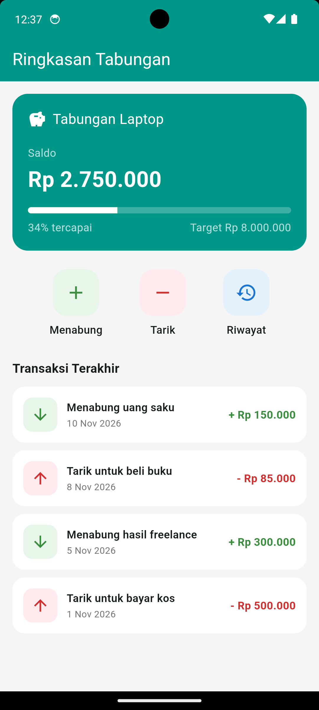
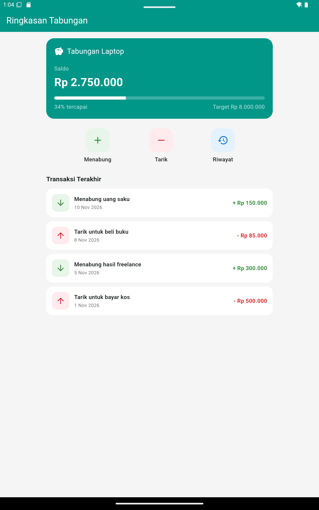

# TabungKu Layout

Layar **Ringkasan Tabungan** untuk aplikasi TabungKu, disusun hanya dengan widget dasar Flutter tanpa paket pihak ketiga.


## Data Mahasiswa

| | |
|---|---|
| **Nama** | Angga Aditya Nugraha |
| **NIM** | 20240801165 |
| **Mata kuliah** | CIE511 – Pemrograman Mobile |
| **Tugas** | Minggu 3 - Menyusun Layout dengan Widget Dasar Flutter |

## Ringkasan

Proyek ini berisi satu halaman statis, `RingkasanPage`, yang merangkum kondisi sebuah tabungan: berapa saldonya, seberapa dekat dengan target, dan transaksi apa saja yang terjadi belakangan. Semua data ditulis langsung di kode (*hard-coded*) karena fokus tugas ada pada tata letak, bukan pada pengelolaan data.

## Tampilan

| Ponsel (potret) | Tablet |
|:---:|:---:|
|  |  |

Tidak ada overflow pada kedua ukuran layar. Pada tablet, isi tetap berada di tengah dengan lebar maksimal 600 px sehingga tidak melebar berlebihan.

## Isi Halaman

- **AppBar** berjudul "Ringkasan Tabungan".
- **Kartu tabungan** (`Card`): nama tabungan, saldo, bilah progres, persentase tercapai, dan target.
- **Tiga penanda kategori** dalam satu baris: Menabung, Tarik, Riwayat.
- **Daftar transaksi terakhir** (4 item), masing-masing memuat judul, tanggal, dan nominal. Transaksi masuk berwarna hijau, transaksi keluar berwarna merah.

## Struktur Layout

```text
MaterialApp
└── RingkasanPage
    └── Scaffold
        ├── AppBar ── Text
        └── body: Center
            └── ConstrainedBox (maks. 600 px)
                └── ListView
                    ├── _KartuTabungan
                    │   └── Card
                    │       └── Padding
                    │           └── Column
                    │               ├── Row ── Icon, Expanded(Text)
                    │               ├── Text (label Saldo)
                    │               ├── Text (nominal saldo)
                    │               ├── Row ── Expanded(Container), Expanded(Container)   <- bilah progres
                    │               └── Row ── Text (persen), Text (target)
                    ├── _BarisKategori
                    │   └── Row ── 3 x _ItemKategori
                    │               └── Column ── Container(Icon), Text
                    ├── Text ("Transaksi Terakhir")
                    └── 4 x _ItemTransaksi
                        └── Container
                            └── Row
                                ├── Container ── Icon
                                ├── Expanded ── Column ── Text (judul), Text (tanggal)
                                └── Text (nominal)
```

## Peran Tiap Widget

| Widget | Dipakai untuk |
|---|---|
| `Scaffold`, `AppBar` | Kerangka halaman dan judul. |
| `Card` | Kartu ringkasan tabungan (nama, saldo, target). |
| `Padding` | Jarak antara isi kartu dan tepi kartu. |
| `Container` | Latar berwarna dan sudut membulat pada bilah progres, kotak ikon, dan baris transaksi. |
| `Column` | Menumpuk elemen ke bawah (isi kartu, ikon + label, judul + tanggal). |
| `Row` | Menjajarkan elemen ke samping (nama + ikon, kategori, baris transaksi). |
| `Expanded` | Membagi sisa lebar; pada bilah progres, `flex` dibuat sebanding dengan persentase tabungan. |
| `SizedBox` | Jarak vertikal dan horizontal antarelemen. |
| `Text`, `Icon` | Teks dan ikon. |
| `ListView` | Membungkus seluruh isi agar bisa di-scroll dan tidak overflow pada layar pendek. |
| `Center`, `ConstrainedBox` | Memusatkan isi dan membatasi lebarnya pada layar lebar. |

Pengaturan jarak dan posisi memakai properti `padding`, `margin`, `mainAxisAlignment`, `crossAxisAlignment`, dan `alignment`.

## Strategi Agar Tidak Overflow

1. **`ListView` sebagai induk** - bila tinggi layar kurang, isi bisa digulir, bukan terpotong.
2. **`Expanded` pada teks panjang** - judul transaksi mengisi sisa lebar dan turun baris bila perlu, sehingga tidak menabrak nominal.
3. **`ConstrainedBox`** - lebar isi dibatasi 600 px agar tampilan tablet tetap proporsional.
4. **Bilah progres berbasis `flex`** - lebarnya otomatis mengikuti lebar kartu di ukuran layar apa pun.

## Cara Menjalankan

Prasyarat: Flutter SDK terpasang (cek dengan `flutter doctor`).

```bash
git clone https://github.com/anggaadityanu/Praktikum-flutter-CR02
cd tugas
cd tabungku_layout
flutter pub get
flutter run
```

Untuk melihat versi tablet, jalankan `flutter run -d chrome`, lalu aktifkan mode perangkat di DevTools (`Ctrl+Shift+M`) dan pilih ukuran tablet. Alternatif lain adalah memakai emulator tablet Android.

## Struktur Proyek

```text
tabungku_layout/
├── lib/
│   └── main.dart        # seluruh kode layar
├── docs/
│   ├── 01-hp.png        # tangkapan layar ponsel
│   └── 02-tablet.png    # tangkapan layar tablet
├── pubspec.yaml
└── README.md
```

